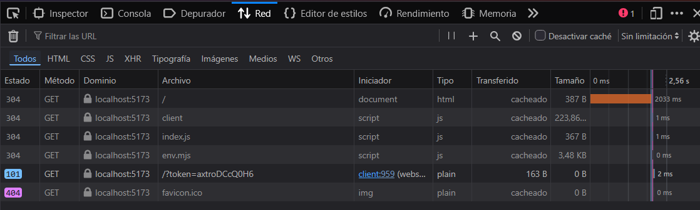
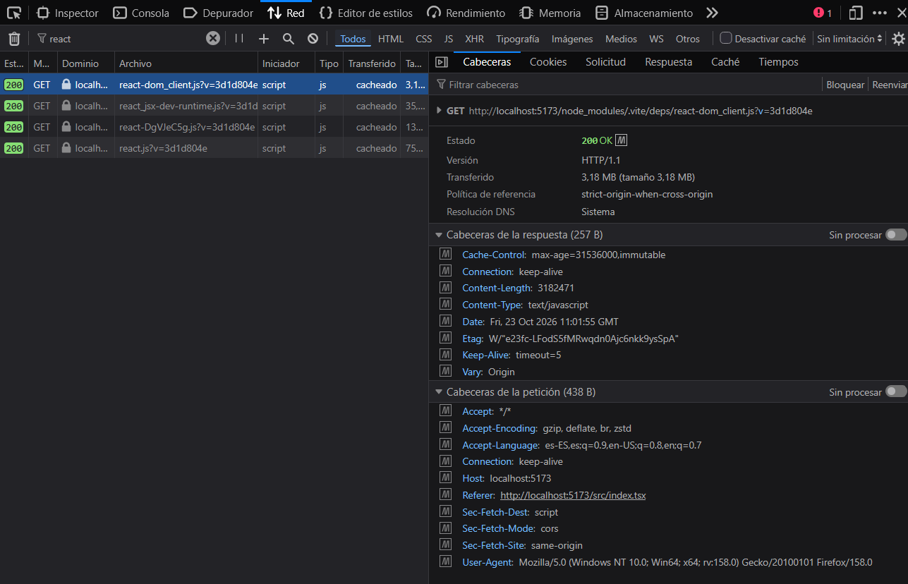
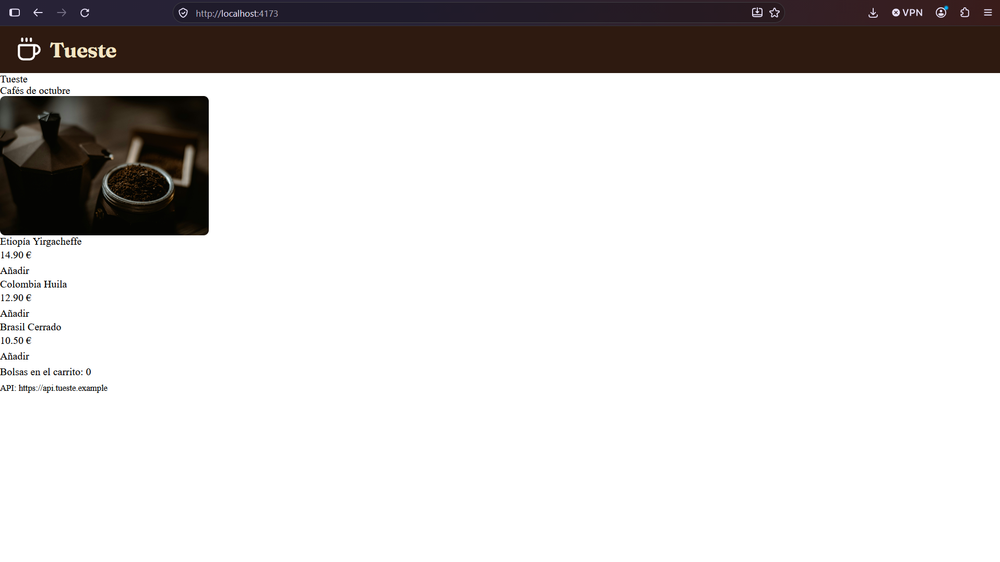

# Tueste · Lab Bundling con Vite

## Puesta en marcha

```bash
npm install
```

| Script | Comando | Para qué sirve |
|---|---|---|
| `start` | `npm start` | Arranca el servidor de desarrollo de Vite en <http://localhost:5173>. Sirve `src/` sin empaquetar, comprueba los tipos y recarga al guardar. |
| `build` | `npm run build` | Genera la versión de producción en `dist/` (minificada y con hash en los nombres). Falla si hay errores de tipos. |
| `preview` | `npm run preview` | Sirve la carpeta `dist/` en <http://localhost:4173> para probar la versión de producción. |

## Respuestas

### 1 · Proyecto desde cero



**¿Para qué sirve el hash del nombre del fichero en producción? ¿Qué pasaría sin él al subir una versión nueva?**

El hash se calcula a partir del contenido del fichero: si el código cambia, cambia el nombre (al cambiar el `console.log` pasó de `index-DBxnL7Ec.js` a `index-CQBpR9o0.js`), y si no cambia, el nombre se mantiene. Así el servidor puede decirle al navegador que guarde esos ficheros en caché mucho tiempo, y en cuanto hay una versión nueva el HTML apunta a un nombre distinto que se descarga sí o sí. Sin hash, el fichero se llamaría siempre igual y los usuarios podrían seguir usando la versión vieja de su caché después de subir la nueva.

**¿Qué diferencia hay entre `npm start` y `npm run preview`? ¿Cuál usarías para comprobar que la versión de producción funciona?**

`npm start` es el servidor de desarrollo: sirve los ficheros de `src/` tal cual, sin empaquetar ni minificar, y los recarga al guardar (por eso aparecen `client`, `env.mjs` y el `?t=<timestamp>`). `npm run preview` no compila nada: sirve lo que ya hay en `dist/`, que es exactamente lo que se subiría a producción. Para comprobar que la versión de producción funciona usaría `npm run build` + `npm run preview`.

### 2 · Estilos con Sass

**¿Por qué en desarrollo el CSS llega como un módulo de JavaScript y en producción como un fichero `.css`?**

En desarrollo, Vite compila el `.scss` y lo envuelve en un módulo JS (`Content-Type: text/javascript`) que mete el CSS en un `<style>` del `<head>` con `updateStyle` y lo quita con `removeStyle`. Al ser un módulo, entra en el sistema de recarga en caliente (HMR): cuando cambio un color, Vite sólo vuelve a enviar ese módulo y se sustituye el `<style>` sin recargar la página (el `console.log` de `index.js` no se repite). En producción no hace falta HMR y lo que importa es el rendimiento, así que Vite extrae todo el CSS a `dist/assets/index-<hash>.css`, ya compilado (las variables `$tueste-900` se han sustituido por `#2e1a10`) y minificado, y lo enlaza con un `<link rel="stylesheet">`: el navegador puede descargarlo en paralelo, cachearlo por separado y aplicar los estilos sin esperar a ejecutar JavaScript.

### 3 · Imágenes

**¿Dónde ha ido a parar el logo y por qué Vite lo trata distinto que la foto? ¿Qué ganamos y qué perdemos con eso?**

El logo no aparece en `dist/assets`: Vite lo ha metido dentro del propio `dist/index.html`, en el `src` del ``, como *data URI* (`data:image/svg+xml,%3csvg...`). Lo decide la opción `build.assetsInlineLimit`, que por defecto vale 4 KiB (4096 bytes): los ficheros por debajo de ese tamaño se incrustan y los que lo superan se copian a `dist/assets` con hash. El logo pesa unos 340 bytes, así que se incrusta; la foto pesa unos 2 MB, así que va a `dist/assets/coffee-<hash>.jpg` y el `import` devuelve su URL. Lo que ganamos es una petición HTTP menos para un fichero diminuto, que llega junto al HTML sin esperar a nada más. Lo que perdemos es que ya no se cachea por separado: va dentro del HTML (o del JS/CSS), que pesa más y se vuelve a descargar entero cada vez que cambia, y si la imagen se usara en varios sitios se repetiría en cada uno. Por eso sólo compensa con ficheros muy pequeños.

### 4 · TypeScript con comprobación de tipos

**¿Por qué Vite, por sí solo, no comprueba los tipos? ¿Qué gana con ello?**

Vite no usa el compilador de TypeScript para servir los `.ts`: usa **oxc**, que se limita a *quitar* las anotaciones de tipo fichero a fichero, sin mirar los demás, y devuelve JavaScript. Comprobar los tipos exige analizar el proyecto entero a la vez (qué exporta cada módulo, qué tipos tienen las librerías…), y eso es muy lento comparado con transpilar un único fichero cada vez que lo pides o lo guardas. Para que transpilar fichero a fichero sea seguro está la opción `isolatedModules`, que hace que TypeScript avise de lo que no se puede traducir sin conocer otros ficheros (por ejemplo, reexportar un tipo sin `export type`). Así Vite arranca y recarga casi al instante, y la comprobación de tipos se deja al editor, a `tsc` o, como aquí, a `vite-plugin-checker`, que la ejecuta en otro proceso sin frenar el servidor y además hace fallar el `build` si hay errores (con `const total: string = 3;` daba `TS2322` y el build terminaba con error).

### 5 · React



**¿Por qué Vite trata distinto a `react` (dependencia) y a `app.tsx` (tu código)? ¿Qué es el pre-bundling y qué problema resuelve?**

Mi código cambia continuamente, así que Vite lo sirve fichero a fichero desde `src/` y deja que el navegador pregunte cada vez si ha cambiado (`app.tsx` responde `304`). Las dependencias de `node_modules` casi nunca cambian, pero vienen en formatos y tamaños poco prácticos: React se publica en CommonJS, que el navegador no entiende como módulo, y otras librerías están partidas en cientos de ficheros que serían cientos de peticiones. El **pre-bundling** consiste en que, al arrancar, Vite empaqueta cada dependencia una sola vez en un único módulo ESM y lo guarda en `node_modules/.vite/deps/` (`react.js`, `react-dom_client.js`). Como el `?v=<hash>` cambia si cambian las versiones instaladas, puede servirlos con `Cache-Control: max-age=31536000, immutable`: tras el primer F5 salen de la caché del navegador sin preguntar siquiera al servidor.

**¿Qué aporta exactamente `@vitejs/plugin-react` si el JSX ya funcionaba sin él?**

Sin el plugin, Vite ya transforma el JSX (oxc lo convierte en llamadas a `jsx()`), pero al guardar `app.tsx` no sabe actualizar sólo ese componente y recarga la página entera: el carrito volvía a 0. El plugin añade **Fast Refresh**: sustituye el componente modificado conservando su estado, así que al cambiar el `<h2>` el título se actualiza y el carrito mantiene sus 3 bolsas.

### 6 · Variables de entorno



**¿Por qué Vite obliga a usar el prefijo `VITE_`?**

Porque todo lo que se lee con `import.meta.env` acaba escrito tal cual dentro del JavaScript que descarga el navegador. Un `.env` puede tener también variables que no deberían salir nunca del servidor o de la máquina de desarrollo (contraseñas, claves…), así que Vite sólo expone las que llevan el prefijo: es una forma de decir explícitamente "esta es pública". Lo comprobé: con `SHOP_NAME` la variable no aparecía en `import.meta.env`, y con `VITE_SHOP_NAME` sí.

**Si mañana cambia la URL de la API de producción, ¿basta con editar `.env.production` en el servidor? ¿Por qué nunca debe ir una clave secreta en una variable `VITE_`?**

No basta: las variables se leen **al hacer el build** y se sustituyen por su valor en el código (en `dist/assets/index-<hash>.js` aparece `api.tueste.example` escrito tal cual). Después el `.env.production` ya no se usa, así que hay que cambiarlo y volver a ejecutar `npm run build` y desplegar el nuevo `dist/`. Por la misma razón nunca debe ir un secreto en una variable `VITE_`: quedaría en un fichero público que cualquiera puede abrir desde las DevTools. Los secretos tienen que quedarse en un servidor propio, que es quien llama a la API que los necesita.

**¿Un *feature flag* desactivado sirve para "esconder" algo a los usuarios?**

No es una forma fiable de esconder nada. En mi caso concreto `Envío gratis` **no** aparece en el bundle de producción: Vite sustituye `import.meta.env.VITE_SHOW_OFFERS` por `"false"`, la comparación `"false" === "true"` se resuelve al construir y el minificador elimina el banner como código muerto. Pero eso depende de cómo esté escrito el código: si el flag llegara en tiempo de ejecución (de una API, de `localStorage`…) o la comprobación fuera menos directa, el texto y la lógica irían en el JS y cualquiera podría leerlos o activarlos. Un flag sirve para decidir qué se muestra, no para proteger información: lo que no deba ver el usuario no debe llegar al navegador.

## Salida final de `npm run build`

```text
vite v8.3.5 building client environment for production...
transforming...
✓ 19 modules transformed.
rendering chunks...
computing gzip size...
dist/assets/favicon-BlvYJjdG.svg      0.33 kB │ gzip:  0.21 kB
dist/index.html                       1.32 kB │ gzip:  0.64 kB
dist/assets/coffee-kqAJzOdl.jpg   2,081.12 kB
dist/assets/index-qRAdAvCk.css        1.64 kB │ gzip:  0.84 kB
dist/assets/index-DSifi2Nh.js       220.23 kB │ gzip: 68.96 kB

✓ built in 311ms
```

## Checklist

**Obligatorios**

- [x] 1 · Proyecto desde cero con Vite (`start`, `build`, `preview`)
- [x] 2 · Estilos con Sass (`@use`, variables, parcial de reset)
- [x] 3 · Imágenes (logo SVG en el HTML, foto importada desde código)
- [x] 4 · TypeScript con comprobación de tipos (`strict` + `vite-plugin-checker`)
- [x] 5 · React con `@vitejs/plugin-react` (Fast Refresh)
- [x] 6 · Variables de entorno (`.env`, `.env.production`, tipadas con `strictImportMetaEnv`)
- [x] 7 · README y bitácora de IA

**Opcionales**

- [ ] Opcional 1 · Tailwind
- [ ] Opcional 2 · Code splitting y análisis del bundle

**Extras**

- Tipografía Fraunces (Google Fonts) para el nombre de la tienda.
- Favicon a partir del logo.

## Bitácora de IA

**Herramienta usada:** Claude Code (Claude Opus 5.5) dentro de VS Code, para organizar el enunciado, montar cada paso y redactar borradores de las respuestas, que luego he revisado comprobando en el navegador y en `dist/`.

### Prompt

"Incluye el modo estricto en tsconfig y montemos vite-plugin-checker"

### Qué me dio

Añadió `"strict": true` al `tsconfig.json`, instaló `vite-plugin-checker` y creó `vite.config.ts` con `checker({ typescript: true })`. Comprobó que con `const total: string = 3;` el build fallaba con `TS2322`.

### Qué corregí y por qué

El `tsconfig.json` que copié del enunciado no traía `strict`, aunque el propio enunciado habla de los errores del "modo estricto" (`Object is possibly 'null'`). La IA lo señaló al montar TypeScript pero no lo añadió hasta que se lo pedí: sin él TypeScript no habría avisado de esos `null`, así que lo activé.

---

### Prompt

"En la parte de Paso 1: comprobar, no me queda muy claro qué es lo que hay que hacer después del build. ¿Podrías continuar?"

### Qué me dio

Un desglose de las comprobaciones del paso 1 (qué mirar en `dist/`, `preview` en el 4173, `start` en el 5173, el `304`, el `?t=` y `new Date(...)`), y además detectó dos fallos en mi `index.html`: faltaba la cabecera con el nombre de la tienda y había un acento grave suelto dentro del `<head>`.

### Qué corregí y por qué

El desglose lo usé tal cual, pero los dos fallos los arreglé yo en el HTML (añadir `<header><h1>Tueste</h1></header>` y borrar el carácter suelto), porque eran errores míos que el enunciado sí pedía.

---

### Prompt

"Vale, seguimos ahora con el siguiente paso?" (paso 3, imágenes)

### Qué me dio

Añadió a `src/index.js` el código del enunciado para importar `./assets/coffee.jpg` y meter la foto en la página, y me dijo qué tenía que comprobar en Network y en `dist/`.

### Qué corregí y por qué

La foto la elegí y descargué yo, y pesaba unos 2 MB, más que los "varios cientos de KB" del enunciado. Además, con el tamaño original no cabía en pantalla y no podía hacer la captura del paso 6, así que pedí limitar su ancho con una regla en `main.scss`. Al ver el build también me fijé en que no todo lo pequeño se incrusta: el favicon SVG sale como fichero aparte en `dist/assets` aunque pese menos de 4 KiB.
